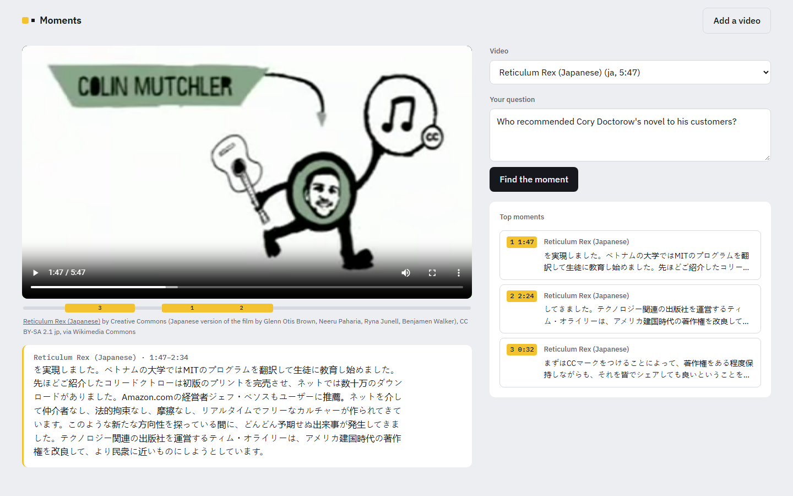

# Moments

**Ask any video, in any language, and jump to the moment that answers.**

Upload a lecture, interview or meeting in Malayalam, Hindi, Arabic, Japanese, English or about 100 other
languages. Ask a question in English or in the video's own language, and Moments takes you to the exact
moments that answer it: clicking one plays the video from there. Everything runs on your own machine, with
no API key and no per-question cost.

Optionally, with an LLM API key, Moments also writes a short answer that cites those moments.



## How it works

```
video ──► speech recognition ──► timed words ──► 40-second windows ──► vectors + keyword index
             (PolySub)            (repaired script)    (overlapping)       (ChromaDB, BM25)

question ──► hybrid search (meaning + keywords, language-aware) ──► top moments ──► (optional) LLM answer
                                                                                    with checked citations
```

1. **Transcribe.** Speech recognition comes from [PolySub](https://github.com/pranavkk7/polysub), which
   already picks the more accurate engine per language by measurement (Qwen3-ASR or Whisper large-v3);
   Malayalam uses Whisper large-v2 (measured below). Every word keeps its start and end time, and a fixed
   random seed makes the same file always give the same transcript.
2. **Repair the script.** Whisper sometimes writes an Indian language in a neighbouring alphabet
   (Malayalam came out in Gurmukhi). Indian scripts share one Unicode layout, so each letter is moved to
   the same place in the right script's block ([moments/scripts.py](moments/scripts.py)).
3. **Cut into windows.** About 40 seconds each, ending at a pause where one is near, overlapping by 10
   seconds so an idea that straddles a cut is whole in one window.
4. **Index twice.** Multilingual embeddings (BAAI/bge-m3) for meaning, so an English question finds a
   Malayalam answer; BM25 for exact names and numbers.
5. **Search.** Both rankings are merged with reciprocal rank fusion. Keyword matches only count when the
   question is in the same script as the video; across languages, meaning alone decides (measured below).
6. **Answer (optional).** With an API key, an LLM sees only the numbered moments, replies in a fixed JSON
   schema, and the code checks that every cited moment is one it was actually given. This part is covered
   by unit tests; the results below measure search, which is what Moments does without a key.

## Results

65 questions over 5 videos in 5 languages, each with the time range where the answer is spoken, read
from the timed transcripts ([eval/questions.json](eval/questions.json)). A result counts when its window
overlaps the answer by at least 3 seconds. `python -m moments.evaluate` reproduces the tables.

| Search | Right moment first | In the top 3 | MRR |
|---|---|---|---|
| **Moments (hybrid, language-aware)** | **72%** | **89%** | **0.81** |
| Meaning only (bge-m3) | 68% | 88% | 0.78 |
| Keywords only (BM25) | 40% | 48% | 0.45 |

Without the Malayalam audiobook (see below), Moments puts the right moment first for 81% of the 52
questions and in the top 3 for 98%. By group (hybrid):

| Video | Questions in | n | First | Top 3 |
|---|---|---|---|---|
| English | English | 12 | 92% | 100% |
| Japanese | English | 12 | 58% | 92% |
| Japanese | Japanese | 4 | 100% | 100% |
| Hindi | English | 8 | 75% | 100% |
| Hindi | Hindi | 3 | 100% | 100% |
| Arabic | English | 10 | 80% | 100% |
| Arabic | Arabic | 3 | 100% | 100% |
| Malayalam | English | 10 | 40% | 50% |
| Malayalam | Malayalam | 3 | 33% | 67% |

What the numbers showed:

- **Keywords can't cross languages.** BM25 found 0% of the English-question moments in the Hindi and
  Arabic videos. Meaning-based search is what makes cross-language search work.
- **But keywords help within a language.** Adding them lifted Arabic-on-Arabic from 67% to 100% first
  place and Japanese-on-Japanese from 75% to 100%.
- **Plain fusion hurt across languages,** so fusion became language-aware. Matching English words against a
  Japanese transcript is noise: English questions on the Japanese video found the right moment first 50%
  of the time with plain fusion and 58% with language-aware fusion (MRR 0.68 to 0.77).

Small test sets: treat differences of one or two questions as noise.

### Malayalam: what went wrong and what helped

Malayalam is the weakest result, and the reason is speech recognition, not search.

1. **Wrong alphabet.** Whisper large-v3 wrote the Malayalam audiobook entirely in Gurmukhi (Punjabi
   script); large-v2 wrote it in Kannada. The sounds were right, the letters were not. The script repair
   moves each letter into the Malayalam block. With large-v2 (whose Kannada maps onto Malayalam almost
   letter for letter) the transcript became readable Malayalam, so Moments uses large-v2 for Malayalam.
2. **Different transcript on every run.** When Whisper loops it retries with random sampling, so runs
   differed; one run found the right moment first for 70% of English questions, another for 40%. A fixed
   random seed now makes runs identical (`eval/repeatability.py`).
3. **Skipped speech.** Even repeatable, Whisper drops whole sentences of this recording (the one about
   the child's 12 days in hospital, for example), and no repair can bring those back. That caps the score.
4. **Keyword matching on joined words.** Malayalam glues words together, so whole words from an imperfect
   transcript rarely match. Matching 3-letter pieces of words instead lifted keyword search on the
   Malayalam questions from 0% to 100% first place, on the version of the transcript that contained them.

The next step would be a speech model trained for Malayalam (for example Digital University Kerala's
fine-tuned Whisper or wav2vec2-BERT models), measured the same way.

## Run it

```bash
python -m venv --system-site-packages .venv     # reuses a CUDA build of PyTorch if installed globally
.venv/Scripts/pip install -e ../polysub -r requirements.txt fastapi "uvicorn[standard]" python-multipart python-dotenv anthropic
copy .env.example .env                           # optional: an API key for written answers

.venv/Scripts/python -m moments add lecture.mp4 --language ml
.venv/Scripts/python -m moments search "when is the exam?"
.venv/Scripts/python -m moments ask "when is the exam?"                  # needs the optional API key
.venv/Scripts/python -m uvicorn moments.api:app --port 8010     # the web page
```

`MOMENTS_DEMO=1` runs the page without uploads (for hosting without a GPU) over an existing library;
`python eval/attach_samples.py` points the sample videos at copies on Wikimedia Commons that every browser
plays, with their credit lines.

Transcription needs an NVIDIA GPU (tested on an RTX 4060, 8 GB). Search runs on the CPU too.

```bash
.venv/Scripts/python -m pytest       # tests use stand-ins: no GPU, model download or API key needed
```

## Sample videos

All from Wikimedia Commons, used under their licences:

| File | Language | Licence |
|---|---|---|
| [Reticulum Rex](https://commons.wikimedia.org/wiki/File:Reticulum_Rex_with_subtitles_-_Creative_Commons.ogv), Creative Commons | English | CC BY-SA 1.0 |
| [Reticulum Rex (in Japanese)](https://commons.wikimedia.org/wiki/File:Reticulum_Rex_(in_Japanese)_-_Creative_Commons..ogv), Creative Commons | Japanese | CC BY-SA 2.1 JP |
| [About The Sengol](https://commons.wikimedia.org/wiki/File:About_The_Sengol,_About_its_History_and_Significance.webm) | Hindi | CC BY 3.0 |
| [Ancient construction practices, Dura-Europos (Djuss)](https://commons.wikimedia.org/wiki/File:Ancient_construction_practices_Dura-Europos_(Djuss).webm) | Arabic | CC BY-SA 4.0 |
| [Nooru Simhasanangal, chapter 4](https://commons.wikimedia.org/wiki/File:%E0%B4%A8%E0%B5%82%E0%B4%B1%E0%B5%81_%E0%B4%B8%E0%B4%BF%E0%B4%82%E0%B4%B9%E0%B4%BE%E0%B4%B8%E0%B4%A8%E0%B4%99%E0%B5%8D%E0%B4%99%E0%B5%BE_%E0%B4%85%E0%B4%A6%E0%B5%8D%E0%B4%A7%E0%B5%8D%E0%B4%AF%E0%B4%BE%E0%B4%AF%E0%B4%82_%E0%B4%A8%E0%B4%BE%E0%B4%B2%E0%B5%8D.ogg) (audiobook) | Malayalam | CC BY-SA 4.0 |

The files themselves are not in the repository (`samples/` is ignored); [eval/samples.json](eval/samples.json) lists
where each came from.
