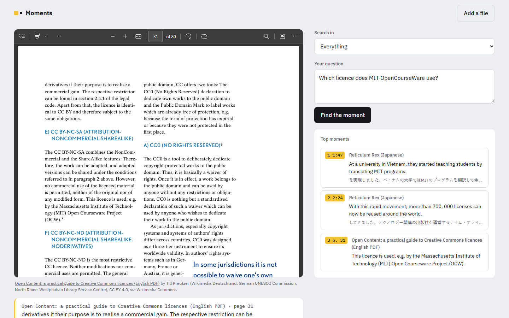

# Moments

**Ask your videos and documents anything, in any language, and jump to the moment or page that answers.**

Add lectures, interviews and meetings in Hindi, Arabic, Japanese, Spanish, English or about 100 other
languages, together with PDFs, Word files and notes. Ask a question in English or in the item's own
language, and Moments takes you to the exact places that answer it: a video at the timestamp, with the
words said there translated into English, or a PDF at the page. One search covers everything at once.
It runs on your own machine, with no API key and no per-question cost.

Optionally, with an LLM API key, Moments also writes a short answer that cites those moments.




## How it works

```
video ──► speech recognition ──► timed words ──► 40-second windows ──┐
             (PolySub)               │                                ├──► vectors + keyword index
                                     └─► English translation (Whisper)┤    (ChromaDB, BM25)
document ──► text, page by page ──► 150-word passages on one page ────┘

question ──► hybrid search (meaning + keywords, language-aware, fair across items) ──► top moments
                                                                  ──► (optional) LLM answer with checked citations
```

1. **Transcribe.** Speech recognition comes from [PolySub](https://github.com/pranavkk7/polysub), which
   already picks the more accurate engine per language by measurement (Qwen3-ASR or Whisper large-v3).
   Every word keeps its start and end time, and a fixed random seed makes the same file always give the
   same transcript.
2. **Translate.** For a video in another language, Whisper also translates the speech into English, with
   its own timings, on the same GPU and without any API. Each window gets the English that was said
   inside it, which the page shows above the original words.
3. **Read documents.** PDFs page by page (pypdf), Word files and plain text. Running headers and
   footers (lines that recur at the top or bottom of many pages) are dropped, words split across lines
   are rejoined, and headings that a small-capitals font turned into "CreATive COmmOns" are put back
   when the document also writes those words normally. The language is detected from the script or the
   commonest words. Scanned PDFs without a text layer are refused with a clear message, since Moments
   does not do OCR.
4. **Cut into windows and passages.** Video windows are about 40 seconds, end at a pause where one is
   near, and overlap by 10 seconds. Document passages are about 150 words, overlap by 30 and never
   cross a page, so every result can name its page.
5. **Index.** Multilingual embeddings (BAAI/bge-m3) for meaning and BM25 for exact names and numbers,
   over the original words and, for videos in other languages, the English translation. Moments keeps
   its own copy of every item's vectors next to ChromaDB's index.
6. **Search.** Up to four rankings are merged with reciprocal rank fusion: meaning and keywords in the
   item's language, and meaning and keywords in English. A keyword match only counts when the question
   is in the same language as the text it matched. Each result's score is averaged over the rankings its
   item can appear in, so videos with a translation don't crowd out documents (measured below).
7. **Show the best sentence.** Each result shows the sentence that best answers the question, chosen by
   comparing every sentence of the moment or passage with the question using the same multilingual
   embeddings (from the English translation for videos in other languages), and the full moment below
   the player marks it.
8. **Answer (optional).** With an API key, an LLM sees only the numbered moments, replies in a fixed JSON
   schema, and the code checks that every cited moment is one it was actually given. This part is covered
   by unit tests; the results below measure search, which is what Moments does without a key.

## Results

85 questions over 5 videos and 2 PDFs in 5 languages ([eval/questions.json](eval/questions.json)). Each
video question has the time range where the answer is spoken, read from the timed transcript; a result
counts when its window overlaps that range by at least 3 seconds. Each document question has the page
the answer is on. `python -m moments.evaluate` reproduces the tables and `python eval/compare_rankings.py`
the comparison of rankings.

**Searching one item** (the question is asked of the video or document it is about):

| Search | Right place first | In the top 3 | MRR |
|---|---|---|---|
| **Moments (four rankings, language-aware)** | **85%** | **99%** | **0.91** |
| Original language only (meaning + keywords) | 81% | 98% | 0.90 |
| Meaning only (bge-m3) | 78% | 95% | 0.87 |
| Keywords only (BM25) | 38% | 53% | 0.45 |

| Item | Questions in | n | First | Top 3 |
|---|---|---|---|---|
| English video | English | 12 | 92% | 100% |
| Spanish video | English | 12 | 100% | 100% |
| Spanish video | Spanish | 3 | 100% | 100% |
| Japanese video | English | 12 | 75% | 100% |
| Japanese video | Japanese | 4 | 100% | 100% |
| Hindi video | English | 8 | 75% | 100% |
| Hindi video | Hindi | 3 | 100% | 100% |
| Arabic video | English | 10 | 90% | 100% |
| Arabic video | Arabic | 3 | 100% | 100% |
| English PDF guide (80 pages) | English | 10 | 40% | 90% |
| Spanish PDF (4 pages) | English | 6 | 100% | 100% |
| Spanish PDF (4 pages) | Spanish | 2 | 100% | 100% |

**Searching the whole library** (every question is asked of all 7 items at once, and a result counts only
when it is the right item and the right moment or page):

| Fusion | Items | First | Top 3 | MRR |
|---|---|---|---|---|
| **Averaged per item (Moments)** | all 85 | **71%** | **92%** | **0.81** |
| | videos 67 | 72% | 91% | 0.81 |
| | documents 18 | 67% | 94% | 0.79 |
| Plain sums | all 85 | 59% | 67% | 0.64 |
| | videos 67 | 73% | 81% | 0.78 |
| | documents 18 | 6% | 17% | 0.13 |

What the numbers showed, in the order the changes were made:

- **Keywords can't cross languages.** BM25 over the original words found 0% of the English-question
  moments in the Hindi and Arabic videos. Meaning-based search is what connects the languages.
- **But keywords help within a language.** Adding them lifted Arabic-on-Arabic from 67% to 100% first
  place and Japanese-on-Japanese from 75% to 100%.
- **So keyword matches must stay within one language.** At first they counted whenever the question and
  the transcript shared a script, which already helped (English questions on the Japanese video: 50% to
  58% first). Spanish showed the flaw: it shares the Latin alphabet with English, so English questions
  were keyword-matched against Spanish words, and the Spanish video scored 92% and 67% first for English
  and Spanish questions while meaning alone scored 100%. Judging the question's language from which text
  its words appear in fixed it: 100% for both.
- **Searching the English translation too was the biggest single gain for videos.** For English questions
  on the four non-English videos it lifted first place from 79% to 86% and put the right moment in the
  top 3 every time; Japanese went from 58% to 75%. The translation alone would have been far worse for
  same-language questions (52% first), so Moments keeps both.
- **Plain fusion was unfair in a mixed library.** Adding up ranks meant a translated video, which sits in
  four rankings, beat a document, which sits in two, even when the document held the answer: only 6% of
  document questions found the right page first when the whole library was searched. Averaging each
  score over the rankings its item can appear in lifted that to 67% and the whole library from 59% to
  71%, without changing any ranking within a single item.
- **The long guide is the hardest item.** Its 80 pages come back to the same licences many times, so the
  first result is often a neighbouring page on the same topic: 40% first, 90% in the top 3. Removing its
  running headers made the results readable but moved two questions from first to second or third
  place (it was 60% first before); with ten questions that is within noise, and the answer pages were
  left as written rather than adjusted after seeing the results.

Small test sets: treat differences of one or two questions as noise.

### Lessons from a fifth language

An early version also had a Malayalam audiobook. Whisper wrote its Malayalam speech in the wrong
alphabet (Gurmukhi with large-v3, Kannada with large-v2), so Moments now repairs transcripts written in
another Indian script by moving each letter to the same place in the right script's Unicode block
([moments/scripts.py](moments/scripts.py)). Whisper also gave a different transcript on every run of that
file, which is why transcription now uses a fixed random seed. Malayalam was then dropped from the
samples, because Whisper still skipped whole sentences of it; a speech model trained for Malayalam would
be the way back.

### A ChromaDB edge case

About once in 25 test runs, ChromaDB could not read its index right after an item's vectors were
replaced ("Error creating hnsw segment reader: Nothing found on disk"). Moments keeps its own copy of
each item's vectors and ranks those exactly when that happens: on the whole test set the fallback gives
the same scores as ChromaDB, and 40 test runs in a row passed after the change.

## Run it

```bash
python -m venv --system-site-packages .venv     # reuses a CUDA build of PyTorch if installed globally
.venv/Scripts/pip install -e ../polysub -r requirements.txt fastapi "uvicorn[standard]" python-multipart python-dotenv
copy .env.example .env                           # optional: an API key for written answers

.venv/Scripts/python -m moments add lecture.mp4 --language hi
.venv/Scripts/python -m moments add handbook.pdf
.venv/Scripts/python -m moments search "when is the exam?"
.venv/Scripts/python -m moments ask "when is the exam?"                  # needs the optional API key
.venv/Scripts/python -m uvicorn moments.api:app --port 8010     # the web page
```

`MOMENTS_DEMO=1` runs the page without uploads (for hosting without a GPU) over an existing library;
`python eval/attach_samples.py` points the samples at their copies on Wikimedia Commons, which every
browser can play or open, with their credit lines.

Transcription needs an NVIDIA GPU (tested on an RTX 4060, 8 GB). Documents and search run on the CPU too.

```bash
.venv/Scripts/python -m pytest       # tests use stand-ins: no GPU, model download or API key needed
```

## Samples

All from Wikimedia Commons, used under their licences:

| File | Language | Licence |
|---|---|---|
| [Reticulum Rex](https://commons.wikimedia.org/wiki/File:Reticulum_Rex_with_subtitles_-_Creative_Commons.ogv), Creative Commons (video) | English | CC BY-SA 1.0 |
| [Reticulum Rex (in Japanese)](https://commons.wikimedia.org/wiki/File:Reticulum_Rex_(in_Japanese)_-_Creative_Commons..ogv), Creative Commons (video) | Japanese | CC BY-SA 2.1 JP |
| [About The Sengol](https://commons.wikimedia.org/wiki/File:About_The_Sengol,_About_its_History_and_Significance.webm) (video) | Hindi | CC BY 3.0 |
| [Ancient construction practices, Dura-Europos (Djuss)](https://commons.wikimedia.org/wiki/File:Ancient_construction_practices_Dura-Europos_(Djuss).webm) (video) | Arabic | CC BY-SA 4.0 |
| ["Las estrellas"](https://commons.wikimedia.org/wiki/File:%22Las_estrellas%22_(Worldnet_TV)..webm), Worldnet TV documentary (video) | Spanish | Public domain |
| [Open Content: A Practical Guide to Using Creative Commons Licences](https://commons.wikimedia.org/wiki/File:Open_Content_-_A_Practical_Guide_to_Using_Creative_Commons_Licences.pdf), Till Kreutzer (PDF, 80 pages) | English | CC BY 4.0 |
| [Planetas del sistema solar](https://commons.wikimedia.org/wiki/File:Planetas_del_sistema_solar.pdf) (PDF, 4 pages) | Spanish | CC BY-SA 4.0 |

The files themselves are not in the repository (`samples/` is ignored); [eval/samples.json](eval/samples.json)
lists where each came from.

## Licence

The code is released under the [MIT licence](LICENSE). The samples keep their own licences (above).
